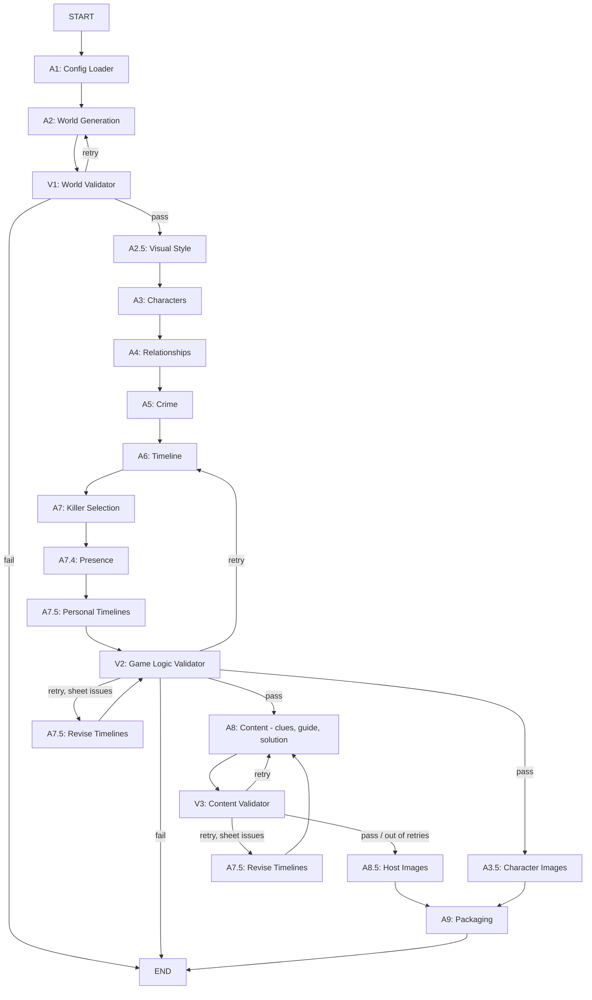

# Developer Guide

This guide explains the architecture, design decisions, and key patterns used in Mystery Agents. If you're planning to contribute or understand how the system works internally, start here.

---

## Table of Contents

1. [Architecture Overview](#architecture-overview)
2. [Agent System](#agent-system)
3. [State Management](#state-management)
4. [Configuration System](#configuration-system)
5. [Validation & Retry Loops](#validation--retry-loops)
6. [Caching Strategy](#caching-strategy)
7. [LLM Integration](#llm-integration)
8. [Image Generation](#image-generation)
9. [Parallel & Batch Operations](#parallel--batch-operations)
10. [Internationalization (i18n)](#internationalization-i18n)
11. [Logging System](#logging-system)
12. [Testing Strategy](#testing-strategy)

---

## Architecture Overview

### High-Level Design

Mystery Agents uses a **pipeline architecture** built on LangGraph with conditional validation loops.

**Key Principles:**
- **Sequential pipeline**: Each agent builds on previous work
- **Validation loops**: Three retry mechanisms (V1 for world coherence, V2 for game logic, V3 for the written content)
- **Immutable state flow**: Each agent receives state, returns modified state
- **Fail-fast**: Critical errors stop the pipeline, minor issues get retried

### Pipeline Flow

```
Config (YAML)
    ↓
┌───────────────────────────────────────────────────────┐
│ PHASE 1: World Setup                                  │
├───────────────────────────────────────────────────────┤
│  A1: Config Loader                                    │
│  A2: World Generation                                 │
│  V1: World Validator ──┐                              │
│    ├─ pass → continue  │  (World Retry Loop)          │
│    └─ fail → retry A2 ─┘  (max 2 retries)            │
│  A2.5: Visual Style                                   │
└───────────────────────────────────────────────────────┘
    ↓
┌───────────────────────────────────────────────────────┐
│ PHASE 2: Characters & Relationships                   │
├───────────────────────────────────────────────────────┤
│  A3: Characters                                       │
│  A4: Relationships                                    │
└───────────────────────────────────────────────────────┘
    ↓
┌───────────────────────────────────────────────────────┐
│ PHASE 3: Crime & Logic                                │
├───────────────────────────────────────────────────────┤
│  A5: Crime                                            │
│  A6: Timeline                                         │
│  A7: Killer Selection (route, deduction plan)         │
│  A7.4: Presence (where everyone is, who sees whom)    │
│  A7.5: Personal Timelines (texts per grid slot; code  │
│        builds the sheets and places the sightings)    │
│    └─ code checks → rewrite flagged suspects once     │
│  V2: Game Logic Validator ──┐                         │
│    ├─ pass → continue        │  (Logic Retry Loop)    │
│    ├─ sheet issues → A7.5 ───┤  (max 3 retries)      │
│    └─ other issues → A6 ─────┘                        │
└───────────────────────────────────────────────────────┘
    ↓
┌───────────────────────────────────────────────────────┐
│ PHASE 4: Content & Packaging                          │
├───────────────────────────────────────────────────────┤
│  A8: Content             ║ A3.5: Character Images     │
│    clues → guide →       ║   (optional, same step     │
│    solution, in turn     ║    as A8)                  │
│  V3: Content Validator   ║                            │
│    ├─ sheet issues →     ║                            │
│    │  A7.5, then A8      ║                            │
│    └─ fail → A8 edits    ║                            │
│       from the first     ║                            │
│       flagged part on    ║                            │
│       (max 2 retries)    ║                            │
│  A8.5: Host Images       ║                            │
│  A9: Packaging (waits for both branches; PDF + ZIP)   │
└───────────────────────────────────────────────────────┘
    ↓
Final Output (ZIP)
```

### Workflow Graph (Mermaid)

For a visual representation:



### Directory Structure

```
src/mystery_agents/
├── agents/                  # Pipeline agents (A1-A9, V1-V3)
│   ├── base.py             # BaseAgent: prompts, structured output, mocks
│   ├── a1_config.py        # Config loader
│   ├── a2_world.py         # World and floor plan
│   ├── v1_world_validator.py
│   ├── a7_4_presence.py    # Presence grid
│   ├── a7_5_personal_timelines.py
│   ├── a8_content.py       # Clue, guide and solution writers
│   ├── v3_content_validator.py
│   ├── a9_packaging.py     # PDF generation & ZIP
│   └── ...
├── graph/                  # LangGraph workflow
│   ├── workflow.py         # Pipeline definition & routing
│   └── checkpoints.py      # SQLite checkpoints for --resume
├── models/
│   └── state.py            # GameState and every Pydantic model in it
├── locales/<code>/ui.json  # Labels of the printed documents
├── utils/                  # Shared utilities
│   ├── prompts.py          # System prompts
│   ├── floor_plan.py       # The shared floor plan
│   ├── presence.py         # Presence grid checks and the sightings it allows
│   ├── timeline_checks.py  # Deterministic checks and fixes of the sheets
│   ├── state_helpers.py    # Safe state access and prompt formatting
│   ├── cache.py            # LLM & agent caching
│   ├── logging_config.py
│   ├── i18n.py             # Translation system
│   └── image_generation.py
└── cli.py                  # CLI entry point
```

---

## Agent System

### Agent Pattern

All agents follow a consistent pattern:

```python
class ExampleAgent(BaseAgent):
    """Agent description."""

    def __init__(self) -> None:
        # Cached LLM shared by every agent of the same tier
        super().__init__(llm=LLMCache.get_model("tier1"), response_format=ExpectedOutput)

    def get_system_prompt(self, state: GameState) -> str:
        """System prompt from utils/prompts.py."""
        return EXAMPLE_SYSTEM_PROMPT

    def run(self, state: GameState) -> GameState:
        """Main entry point - modifies and returns state."""
        # Mock mode for --dry-run and tests
        if self._should_use_mock(state):
            return self._mock_output(state)

        # Structured output via BaseAgent; raises StructuredOutputError if it doesn't parse
        result = self.invoke(state, self._request(state))

        state.some_field = result.some_value
        return state

    def _mock_output(self, state: GameState) -> GameState:
        """Mock data for --dry-run mode."""
        state.some_field = "mock_value"
        return state
```

`BaseAgent.invoke()` prepends `FICTION_CONTEXT` and, for non-English games, the language
instructions to the system prompt. An agent can override `get_response_format()` to narrow
the schema to the current game (A7.4 only accepts the floor plan's rooms).

### Agent Lifecycle

1. **Creation**: Agents are created once and cached by `AgentFactory`
2. **Invocation**: Workflow calls `agent.run(state)` in each node
3. **Reuse**: Same agent instance is reused in retry loops
4. **Stateless**: Agents don't maintain internal state (everything in GameState)

### Why This Pattern?

- **Testability**: Easy to test agents in isolation
- **Dry-run mode**: All agents support mock data for testing
- **Consistent API**: Every agent has `run(state) -> state`
- **Structured output**: Pydantic models ensure type safety
- **Reusability**: Agents are cached and reused efficiently

---

## State Management

### GameState Structure

The entire game generation is captured in `GameState`:

```python
class GameState(BaseModel):
    meta: MetaInfo                                  # Game ID, timestamp
    config: GameConfig                              # User configuration
    world: WorldBible | None                        # A2 output (with the floor plan)
    visual_style: VisualStyle | None                # A2.5 output
    characters: list[CharacterSpec]                 # A3 output
    relationships: list[RelationshipSpec]           # A4 output
    crime: CrimeSpec | None                         # A5 output
    timeline_global: GlobalTimeline | None          # A6 output
    killer_selection: KillerSelection | None        # A7 output (route, deduction plan)
    presence: PresenceGrid | None                   # A7.4 output
    personal_timelines: dict[str, PersonalTimeline] # A7.5 output, by character ID
    clues: list[ClueSpec]                           # A8 output
    host_guide: HostGuide | None                    # A8 output (with the solution)
    character_image_paths: dict[str, str]           # A3.5 output
    packaging: PackagingInfo | None                 # A9 output

    # Validation state
    world_validation: WorldValidation | None        # V1
    validation: ValidationReport | None             # V2
    content_validation: ValidationReport | None     # V3
    world_retry_count: int = 0
    retry_count: int = 0
    content_retry_count: int = 0
```

### Design Decisions

**Why a single large state object?**
- LangGraph requires state to flow through nodes
- All agents need access to previous outputs
- Easy to serialize/debug entire game state
- Type-safe with Pydantic validation

**Why optional fields?**
- State is built incrementally through the pipeline
- Early agents populate fields for later agents
- Validation can check if required fields exist

**Why separate validation state?**
- Retry loops need to track attempt counts
- Validation results inform routing decisions
- Keeps domain models clean

---

## Configuration System

### Two-Level Configuration

**1. User Configuration (YAML → GameConfig)**
```yaml
# game.yml - User defines game parameters
language: es
country: Spain
epoch: modern
theme: family_mansion
players:
  male: 3
  female: 3
```

**2. System Constants (`utils/constants.py`)**
```python
# Developer-defined system defaults
DEFAULT_RECURSION_LIMIT = 50
IMAGE_GENERATION_MODEL = "gemini-nano-banana-2.1"
LLM_PROVIDER_DEFAULT = "openai"
LLM_MODELS = {"openai": {"tier1": "gpt-6-luna", ...}, "google": {"tier1": "gemini-3.6-flash", ...}}
IMAGE_GENERATION_MAX_CONCURRENT = 5
```

### Why This Split?

- **User config**: Game-specific settings (what to generate)
- **System constants**: Technical settings (how to generate)
- **Separation of concerns**: Users don't need to know about models or limits
- **Type safety**: GameConfig uses Pydantic, constants are simple Python values

### Environment Variables

```bash
# .env file
LLM_PROVIDER=openai          # Text provider: openai (default) or google
OPENAI_API_KEY=xxx           # Text with openai
GOOGLE_API_KEY=xxx           # Portraits (always Gemini), and text with google
LLM_MODEL_TIER1=gpt-6-luna   # Optional override of the provider's default
LLM_MODEL_TIER2=gpt-6-luna
LLM_MODEL_TIER3=gpt-6-luna
```

Loaded via `python-dotenv` in `cli.py`, accessed via `os.getenv()` in `config.py`.

---

## Validation & Retry Loops

### Three Validation Points

Routing lives in `graph/workflow.py`:

- **V1: World validation (after A2)** - `should_retry_world_validation()` sends an
  incoherent world back to A2, at most `max_world_retries` (2) times, then ends the run.
- **V2: Game logic validation (after A7.5)** - `route_after_game_validation()` sends
  issues inside the suspects' sheets (`fix_in="timelines"`) back to A7.5's revision and
  anything else back to A6, at most `max_retries` (3) times. When retries run out and
  only the sheets still have issues, the game continues; otherwise the run ends.
- **V3: Content validation (after A8)** - `should_retry_content_validation()` sends
  sheet issues to A7.5's revision and then A8, and other issues back to A8, which
  rewrites from the first flagged part on, at most `max_content_retries` (2) times.
  After that the last version is packaged anyway.

Before V2, code checks and fixes what it can measure (`utils/timeline_checks.py`,
`utils/presence.py`): sightings the grid or the floor plan rules out, too many killer
witnesses, words that give an unaware killer away. A7.5 rewrites the flagged suspects
once before V2 sees the sheets.

### Why Three Loops?

- **World validation**: Catches location/setting issues early
- **Logic validation**: Ensures killer logic, timeline and sheets are consistent
- **Content validation**: Checks clues, guide and solution against what players hold
- **Performance**: Fix issues before generating expensive content
- **Max retries**: Prevents infinite loops

### What Gets Validated?

**V1 (World)**:
- Location coherence (rooms make sense for theme/epoch)
- Cultural consistency (names, customs match country/region)
- Historical accuracy (items, technology match epoch)

**V2 (Game Logic)**:
- Killer has motive, means, opportunity
- Timeline and sheets are consistent
- The deduction plan makes the case solvable and not obvious

**V3 (Content)**:
- Clues, guide and solution agree with the sheets
- No spoilers, unsupported evidence or single clue that solves the case

---

## Caching Strategy

### Why Caching?

**Problem**: Without caching, a typical game creates:
- 30+ LLM instances (one per agent invocation)
- 17+ agent instances (especially in retry loops)
- 10-15 seconds of initialization overhead

**Solution**: Multi-level caching

### Level 1: LLM Cache

```python
from mystery_agents.utils.cache import LLMCache

# Instead of creating new instances
llm = LLMCache.get_model("tier1")  # Cached, reused
```

**Result**: At most 3 LLM instances (tier1, tier2, tier3)

### Level 2: Agent Cache

```python
from mystery_agents.utils.cache import AgentFactory

# In workflow.py
agent = AgentFactory.get_agent(WorldAgent)  # Cached, reused in retries
```

**Result**: One instance per agent class

### Performance Impact

- **~80% reduction** in LLM instance creation
- **~60% faster** initialization
- **Retry loops** don't slow down execution (agents are reused)
- **Reduced memory** footprint

### Usage in Code

**For agent developers:**
```python
class MyAgent(BaseAgent):
    def __init__(self):
        llm = LLMCache.get_model("tier2")  # Use this instead of LLMConfig
        super().__init__(llm=llm, ...)
```

**For workflow developers:**
```python
def my_node(state: GameState) -> GameState:
    agent = AgentFactory.get_agent(MyAgent)  # Use this instead of MyAgent()
    return agent.run(state)
```

---

## LLM Integration

### Three-Tier System

We use **tiered LLMs** based on task complexity. `LLM_PROVIDER` picks the provider for every
text tier (`config.py`); images always use Gemini (`utils/image_generation.py`).

| Tier | OpenAI (default) | Google | Use Case | Examples |
|------|------------------|--------|----------|----------|
| **Tier 1** | gpt-6-luna | gemini-3.6-flash | Complex reasoning | World, crime, killer selection, presence grid, personal timelines, clues, guide and solution (A8), V2, V3 |
| **Tier 2** | gpt-6-luna | gemini-3.6-flash | Content generation | Visual style, characters, relationships, timeline, V1 |
| **Tier 3** | gpt-6-luna | gemini-3.5-flash-lite | Never called | Placeholder for the image agents and packaging, which don't call a text model |

### Why Tiered?

- **Cost optimization**: Use faster/cheaper models where possible
- **Flexibility**: Easy to upgrade specific tiers
- **Override**: Set via environment variables

### Structured Output

All agents use Pydantic models for LLM responses. `BaseAgent` wraps the model with
`config.structured_output()`, which calls `with_structured_output(..., method="json_schema",
include_raw=True)`, in strict mode for OpenAI, so the model returns JSON constrained by the
schema (native structured output, no function calling). `tests/unit/test_llm_config.py`
checks that every response schema converts to OpenAI's strict format:

```python
class WorldOutput(BaseModel):
    location_name: str
    location_type: str
    rooms: list[Room]
    epoch_description: str

# In agent
result = self.invoke(state, user_message)
# result is type-safe WorldOutput, not raw text
```

**Benefits**:
- Type safety
- Automatic validation
- Self-documenting API

**Schema caveat**: Gemini does not enforce every JSON Schema keyword. In particular
it ignores `const`, which Pydantic emits for single-value `Literal` fields. Use a
plain default (not an LLM-facing field) for fixed values; multi-value `Literal`
enums work fine.

If the response can't be parsed, `BaseAgent.invoke()` raises `StructuredOutputError`
(a `ValueError`) with the parsing error, and the graph retries the node up to
`NODE_MAX_ATTEMPTS` times.

### Debug Output

The `--debug` flag prints each raw model response and the parsed output
(`utils/debug_output.py`):

```python
# In BaseAgent.invoke()
if state.config.debug_model:
    log_model_response(result["raw"], parsed, parsing_error)
```

**Use cases**:
- Debugging prompt engineering
- Understanding validation failures
- Improving mock data quality

---

## Image Generation

### Implementation

Uses **Nano Banana 2.1** via LangChain:

```python
# utils/image_generation.py (client shared via functools.cache)
llm = ChatGoogleGenerativeAI(
    model="gemini-nano-banana-2.1",
    temperature=0.6,
    response_modalities=["IMAGE"],
)

message = HumanMessage(content=[{"type": "text", "text": prompt}])

resp = await llm.ainvoke([message])

# Pick the first standard image block and save it
img_b64 = next(b.get("base64") for b in resp.content_blocks if b["type"] == "image")
```

### Async + Retry Logic

```python
async def generate_image_with_gemini(
    prompt: str,
    output_path: Path,
    max_retries: int = 3,
    retry_delay_base: float = 2.0,
) -> bool:
    for attempt in range(max_retries):
        try:
            await _call_gemini_image_api(prompt, output_path)
            return True
        except Exception as e:
            if attempt < max_retries - 1:
                delay = retry_delay_base * (2**attempt)
                logger.warning(f"Attempt {attempt + 1}/{max_retries} failed: {e}")
                await asyncio.sleep(delay)
            else:
                logger.error(f"Failed after {max_retries} attempts: {e}")
    return False
```

**Why this approach?**
- **Exponential backoff**: Handles rate limits gracefully
- **Async**: Non-blocking for parallel generation
- **Retry logic**: Recovers from transient failures
- **Returns bool**: Workflow continues even if images fail

### Prompt Engineering

Images use detailed prompts with:
- Character name, age, gender, role
- Personality traits
- Historical period (1920s, Victorian, etc.)
- Cultural context (Spain, England, etc.)
- Visual style requirements (photorealistic, period-appropriate)
- Negative prompts (no text, no watermarks)

---

## Parallel & Batch Operations

### Image Generation (A3.5)

```python
async def _generate_all_images_async(
    self,
    image_tasks: list[tuple],
    semaphore: asyncio.Semaphore,
) -> list[str]:
    """Generate images in parallel with rate limiting."""
    tasks = [
        self._generate_single_image(character, prompt, semaphore)
        for character, prompt in image_tasks
    ]
    return await asyncio.gather(*tasks, return_exceptions=True)
```

**Key patterns**:
- **Semaphore**: Limits concurrent API calls (default: 5)
- **asyncio.gather**: Runs all tasks in parallel
- **return_exceptions=True**: Doesn't fail entire batch on one error

### PDF Generation (A9)

```python
with ProcessPoolExecutor(max_workers=PDF_MAX_WORKERS) as executor:
    futures = [
        executor.submit(_generate_pdf_worker, task)
        for task in tasks_with_settings
    ]
    for future in futures:
        result = future.result(timeout=PDF_TIMEOUT_SECONDS)
```

**Key patterns**:
- **ProcessPoolExecutor**: True parallelism (bypasses GIL)
- **Worker function**: Must be module-level for pickling
- **Timeout**: Prevents hanging on bad PDFs
- **Progress reporting**: Shows user what's happening

### Why Different Approaches?

- **Images**: Async I/O (waiting on API), use asyncio
- **PDFs**: CPU-bound (WeasyPrint rendering), use processes
- **Trade-off**: Processes have overhead, but PDFs are CPU-intensive

---

## Internationalization (i18n)

### Architecture

```
TranslationManager (one instance per language)
  ├── locales/en/ui.json  # Source language and fallback
  ├── locales/es/ui.json  # Spanish
  └── locales/<code>/ui.json  # it, de, he
```

### Usage

```python
from mystery_agents.utils.i18n import TranslationManager, get_document_labels

tm = TranslationManager("es")

# Dot-notation key
label = tm.get("document.host_guide_title")

# With variables
text = tm.get("document.some_key", name="Elena")

# Entire section, as the document writers use it
labels = get_document_labels("es")
# Returns: {"host_guide_title": "...", ...}
```

### Design Decisions

**Why JSON instead of .po/.pot files?**
- Simpler for developers (no special tools needed)
- Easy to validate structure
- Built-in Python support
- Can nest keys for organization

**Why singleton?**
- Translation files loaded once
- Cached for performance
- Consistent across entire app

**Why no gettext?**
- LLMs generate content in target language natively (not translated)
- Only UI labels/document titles need i18n
- JSON is sufficient for this use case

### Language Injection Pattern

For non-English games, we inject special instructions into LLM prompts:

```python
# BaseAgent._get_language_injection(), simplified
def _get_language_injection(self, state: GameState) -> str:
    if state.config.language == "en":
        return ""
    target_lang = get_language_name(state.config.language)
    return f"""
CRITICAL LANGUAGE REQUIREMENTS (HIGHEST PRIORITY):
1. Output Language: ALL creative and narrative content MUST be written in {target_lang}.
2. JSON Structure Integrity: Keep ALL JSON keys in English.
...
"""
```

**Why injection vs translation?**
- Native generation is better than translation
- Preserves cultural context
- More natural language
- Cheaper (one LLM call instead of two)

---

## Logging System

### Architecture

```python
AgentLogger (Wrapper)
  ├── Default mode: click.echo() for visual progress
  ├── -v mode: logging.info() with timestamps
  ├── -vv mode: logging.debug() with cache details
  └── --log-file: Always writes INFO+ to file
```

### Usage in Agents

```python
def run(self, state: GameState) -> GameState:
    log = AgentLogger(__name__, state)
    
    log.info("Generating world...")  # Adapts to verbosity mode
    log.debug("Using cached LLM")    # Only in -vv
    log.info("✓ World generated")
    
    return state
```

### Why AgentLogger?

- **Abstracts verbosity logic**: Agents don't need if/else for logging
- **Consistent formatting**: `[agent_name]` tags automatically
- **File logging**: Decoupled from console verbosity
- **Clean API**: `log.info()`, `log.debug()`, `log.error()`

### Verbosity Levels

| Level | Output | Use Case |
|-------|--------|----------|
| Default | Visual progress | User-friendly |
| `-v` | INFO logs + timestamps | Debugging, CI/CD |
| `-vv` | INFO + DEBUG logs | Deep debugging |
| `--quiet` | Config + result + errors | Automation |
| `--log-file` | Always INFO+ to file | Post-analysis |

### Design Decision: Why not just use Python logging everywhere?

- **User experience**: Default mode is cleaner without timestamps/levels
- **Best of both worlds**: Visual progress for users, structured logs for analysis
- **Log file independence**: Can have clean console + detailed file

---

## Testing Strategy

### Test Hierarchy

```
tests/
├── unit/                  # Fast, isolated tests
│   ├── test_agents.py    # Agent logic without LLM calls
│   ├── test_cache.py     # Caching behavior
│   ├── test_i18n.py      # Translation logic
│   └── test_validators.py
├── integration/          # Multi-component tests
│   ├── test_workflow.py  # Full pipeline in dry-run mode
│   ├── test_cli.py       # CLI argument parsing
│   └── test_agents_integration.py
└── conftest.py           # Shared fixtures
```

### Testing Agents

**Unit tests** (no LLM calls):
```python
def test_world_agent_mock_output():
    """Test agent logic without API calls."""
    agent = WorldAgent()
    state = GameState(config=GameConfig(dry_run=True, ...))
    
    result = agent.run(state)
    
    assert result.world is not None
    assert result.world.location_name
```

**Integration tests** (full pipeline):
```python
def test_workflow_dry_run():
    """Test entire workflow with mock data."""
    state = GameState(config=GameConfig(dry_run=True, ...))
    
    workflow = create_workflow()
    final_state = workflow.invoke(state)
    
    assert final_state["packaging"] is not None
```

### Mocking Strategy

**For LLM calls**:
- Use `dry_run=True` mode
- Each agent has `_mock_output()` method
- Tests run fast (no API calls)

**For external dependencies**:
```python
from unittest.mock import patch

@patch("mystery_agents.utils.image_generation.ChatGoogleGenerativeAI")
def test_image_generation(mock_llm):
    mock_llm.return_value.invoke.return_value = mock_response
    # Test image generation logic
```

### Test Coverage Goals

- **Unit tests**: 90%+ coverage of core logic
- **Integration tests**: All happy paths + validation loops
- **CLI tests**: All flags and error cases
- **I18n tests**: All languages have same keys

### Measuring Game Quality

Unit tests check the code; whether the games are good needs real runs. To measure a change:

```bash
scripts/eval.sh 4                 # 4 games from game.example.yml into eval/<timestamp>/
```

Then review each game with one agent using `docs/EVAL_RUBRIC.md`, and compare the SUMMARY blocks
(contradictions, spoilers, the six scores) with the previous batch. Single games vary a lot, so judge a
change by the batch, and keep the rubric unchanged between the batches you compare.

---

## Contributing

### Before You Start

1. Read this guide
2. Check `TODO.md` for planned work
3. Run tests: `uv run pytest`
4. Verify linting: `uv run ruff check .`

### Adding a New Agent

1. Create agent file: `src/mystery_agents/agents/aX_name.py`
2. Follow agent pattern (see Agent System section)
3. Add Pydantic model for output
4. Implement `_mock_output()` for testing
5. Add node to workflow: `src/mystery_agents/graph/workflow.py`
6. Write unit tests: `tests/unit/test_name.py`
7. Update `README.md` if user-facing

### Modifying the Pipeline

1. Update workflow graph: `src/mystery_agents/graph/workflow.py`
2. Update `GameState` if adding new fields
3. Add routing logic if needed
4. Update integration tests
5. Update architecture diagram in README

### Code Style

- **Language**: English (code, comments, docs)
- **Type hints**: All functions must have type annotations
- **Docstrings**: Google style for public APIs
- **Formatting**: `ruff format .`
- **Linting**: `ruff check . --fix`
- **Tests**: Required for new features

### Commit Messages

Follow conventional commits:
```bash
feat: add new agent for X
fix: resolve issue with Y
docs: update developer guide
test: add tests for Z
refactor: simplify cache logic
```

---

## Additional Resources

- **Main README**: User documentation and quick start
- **Code**: Most modules have detailed docstrings
- **Tests**: Unit tests serve as usage examples
- **Issues**: Check GitHub for known issues and discussions

---

## Questions?

If something is unclear or missing from this guide, please:
1. Open an issue on GitHub
2. Propose improvements via PR
3. Ask in discussions

This guide should evolve as the project grows!
